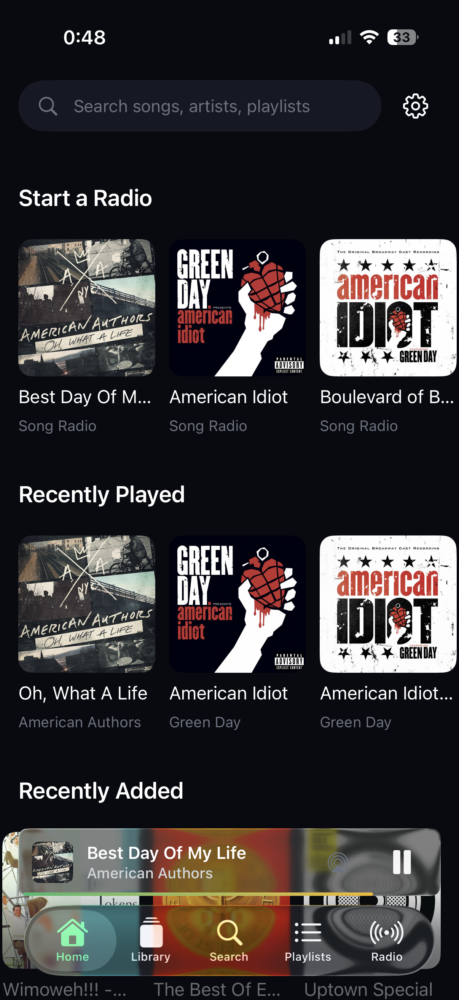

# lemonpi

A (lemon themed) self-hosted home server ecosystem running on a trusty Raspberry Pi, with some dockerized apps and services :p

## Overview

I’ve always wanted a centralized home server setup that I completely own, configure, and control, rather than relying on external cloud providers. `lemonpi` is my dedicated bare-metal and containerized hub for home automation, file management, and media streaming.

Powered by a Raspberry Pi 3, the server runs a modular Docker Compose stack that allows me to backup my files and pictures, freely listen to music without ads, and casually tinker with when I feel like it, all with the added perk of being styled to my liking.

I had a blast setting it up over the past few days, and will probably tweak some things here and there but for now it's at quite a nice place for what I had in mind. With that being said here is a tour :)

---

## hronological Server Evolution & Setup

The journey from initial hardware assembly to a pira- I mean to it being fully operational went as follows:

### 1. Initial Assembly & Boot
I started by throwing rpi os lite on it (no reason to have the full os gui, we need to save our ram these days lol) and ssh'ing as soon as it was ready. Lastly for this step
came the whole file layout for the hard drive that will be carrying this build's storage needs.
<p align="center">
  
  <br>
  <em>Initial hardware staging and server boot tests.</em>
</p>

<p align="center">
  
  <br>
  <em>The active terminal environment tracking server metrics and system status.</em>
</p>

### 2. Core Service Deployment & Scraping Pipeline

I continued by setting up the tailscale vpn/tunnel service as well as docker for my would be containers.
I then set up filestash as a remote web frontend for the cloud storage aspect of the server, navidrome for the music hosting,
and a scraper script to yoink all the songs I would want off the internet which I then gave a frontend for by bullying an llm.

<p align="center">
  
  <br>
  <em>The backend application structuring ingestion pipelines and API routing.</em>
</p>

<p align="center">
  
  <br>
  <em>Indexing downloaded tracks and metadata automatically into the Navidrome media server.</em>
</p>

<p align="center">
  
  <br>
  <em>Managing file structures and directories via Filestash.</em>
</p>

### 3. Remote Access & Client Experience

lastly I downloaded a wrapper/client mobile-app to connect to the navidrome container, and I gotta say I like how close it
looks to the likes of spotify/apple music and such.

<p align="center">
  
  <br>
  <em>The mobile-responsive web dashboard used to submit Spotify links directly to the server.</em>
</p>

<p align="center">
  
  <br>
  <em>A look behind the scenes during the build process.</em>
</p>

---

## Architecture & Behind the Scenes

### 1. Networking & Remote Access (`Tailscale`)
Exposing services publicly is a security nightmare, and traditional port forwarding is a headache. 
I opted for using tailscale so I could have a private mesh network. Whether I'm on my laptop at university or out and about, 
I can securely SSH into the Pi or hit local web UIs via encrypted tailnets without ever poking holes in my home router firewall 
as I doubt my family would like to deal with that.

### 2. Storage & File Management (`OpenMediaVault & Filestash`)
At the hardware layer, disks are managed via OpenMediaVault to provide reliable network-attached storage. 
For quick file access on the go without firing up an SFTP client, Filestash provides a clean, responsive web interface right on top of the storage pools.

### 3. Media Pipeline (`Navidrome & LemonChello`)
Listening to music has always been something that I enjoyed, there hasn't really been a day where I didn't zone out to my playlists for at least a few hours. Because of that, 
when setting up this server I wanted an intuitive way for me to move as many songs from my main playlists to the server as possible, and to also then have a nice app to then 
browse them all with.  
- **Navidrome** acts as the blazing-fast music server, serving high-bitrate MP3 libraries straight to any client.
- **LemonChello** acts as the automated bridge: it takes Spotify playlist or track links, matches them cleanly against YouTube via `yt-dlp`, embeds high-resolution cover art, ID3 tags, and synchronized lyrics via Mutagen, and drops them right into the Navidrome library folders—automatically triggering an index scan when finished.
As for the mobile side I've come to enjoy substreamer and Subsonify (IOS, adroid maybe?), both are great, though there are plenty of other options for basically any platform you choose.

---

## 🛠️ Deployment & Maintenance

Everything on `lemonpi` is containerized. Docker Compose handles lifecycle management, ensuring that if a service hiccups, it restarts cleanly without taking down the rest of the ecosystem.

```yaml
# Example snippet of the containerized philosophy keeping lemonpi lean
version: "3.8"
services:
  lemonchello:
    build: .
    restart: unless-stopped
    environment:
      - MUSIC_DIR=/music
    volumes:
      - /srv/dev-disk-by-uuid/storage/Music:/music
      - ./.cache:/app/.cache
