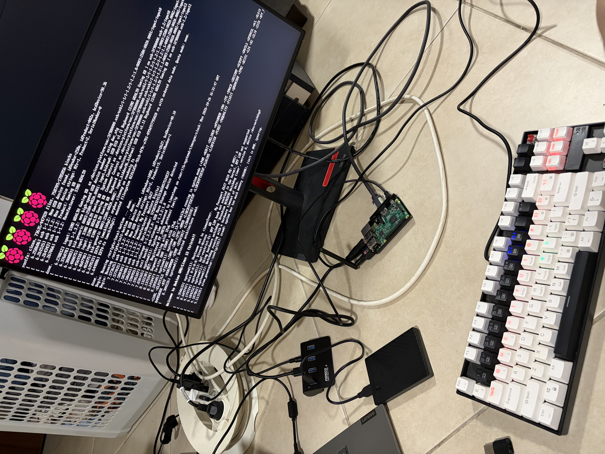
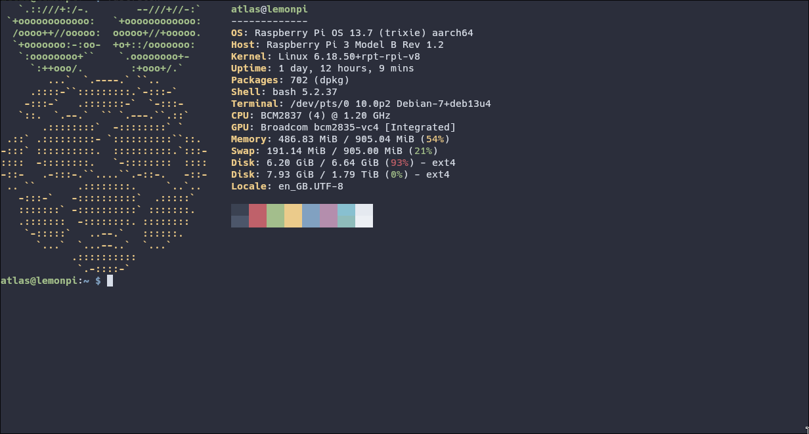
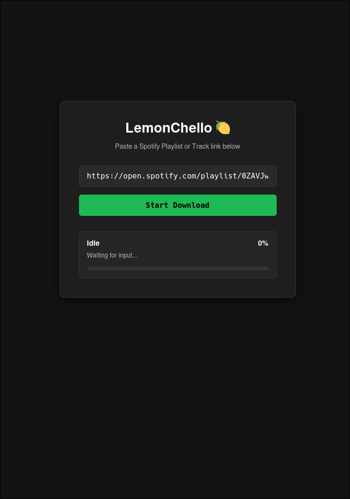
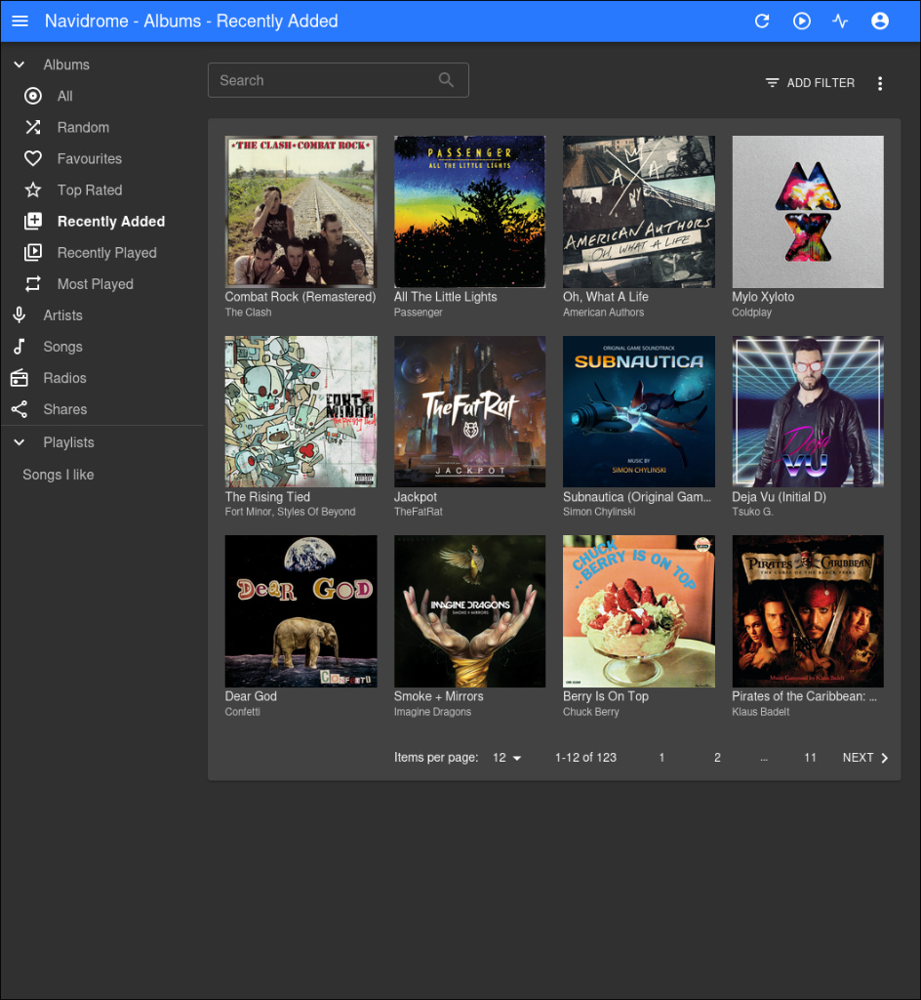
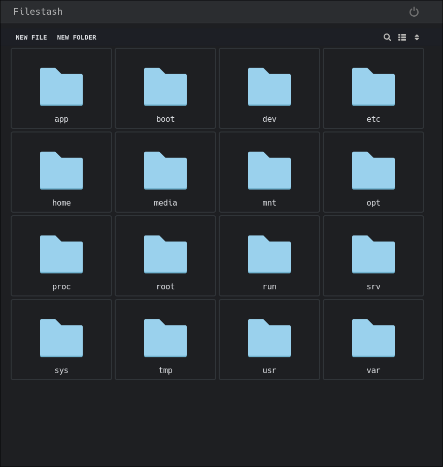
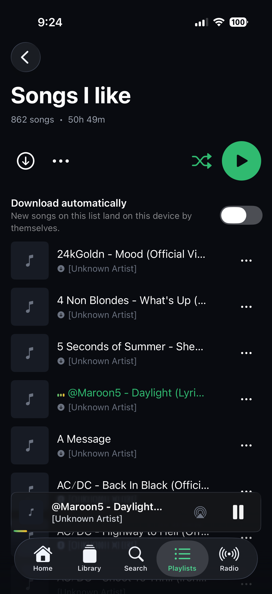
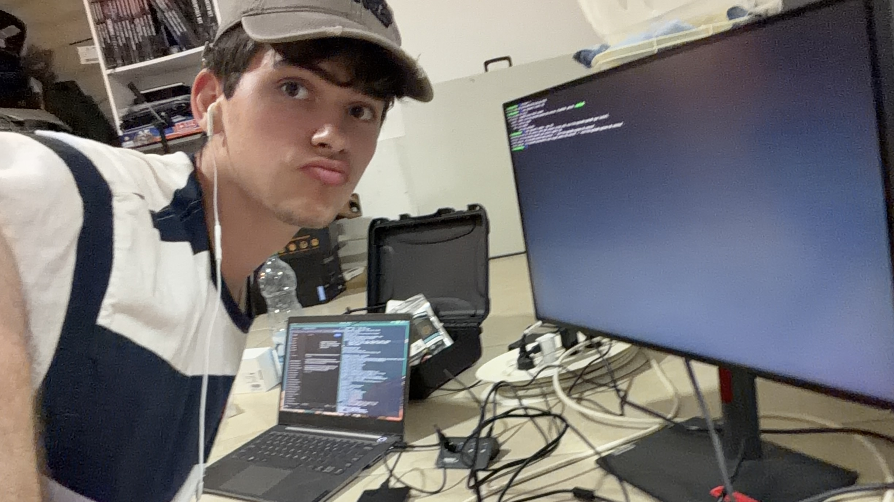

# lemonpi

A self-hosted home server ecosystem running on a trusty Raspberry Pi 3—handling media storage, automated scraping, music streaming, and private containerized services over a secure Tailscale mesh.

## Overview

I’ve always wanted a centralized home server setup that I completely own, configure, and control, rather than relying on external cloud providers. `lemonpi` is my dedicated bare-metal and containerized hub for home automation, file management, and media streaming.

Powered by a Raspberry Pi 3, the server runs a modular Docker Compose stack. It bridges local network storage with remote access, tying together file navigation, automated music downloading, and zero-trust VPN networking.

The setup is built around stability, low resource footprint, and absolute data privacy.

---

## 🗺️ Chronological Server Evolution & Setup

The journey from initial hardware assembly to a fully automated pipeline unfolded across several stages:

### 1. Initial Assembly & Terminal Boot
Getting the physical hardware staged, booted, and configured with the base system environment and system monitoring tools.

<p align="center">
  
  <br>
  <em>Initial hardware staging and server boot tests.</em>
</p>

<p align="center">
  
  <br>
  <em>The active terminal environment tracking server metrics and system status.</em>
</p>

### 2. Core Service Deployment & Scraping Pipeline
Writing the backend logic, deploying Docker Compose over Tailscale, and setting up the music scraping and library sync tools.

<p align="center">
  
  <br>
  <em>The backend application structuring ingestion pipelines and API routing.</em>
</p>

<p align="center">
  
  <br>
  <em>Indexing downloaded tracks and metadata automatically into the Navidrome media server.</em>
</p>

<p align="center">
  
  <br>
  <em>Managing file structures and directories via Filestash.</em>
</p>

### 3. Remote Access & Client Experience
Integrating mobile web controls and documenting the final deployed environment.

<p align="center">
  
  <br>
  <em>The mobile-responsive web dashboard used to submit Spotify links directly to the server.</em>
</p>

<p align="center">
  
  <br>
  <em>A look behind the scenes during the build process.</em>
</p>

---

## ⚡ Architecture & Behind the Scenes

### 1. Networking & Remote Access (`Tailscale`)
Exposing services publicly is a security nightmare, and traditional port forwarding is a headache. `lemonpi` sits safely behind a private Tailscale mesh network. Whether I'm on my Arch Linux laptop at university or out and about, I can securely SSH into the Pi or hit local web UIs via encrypted tailnets without ever poking holes in the home router firewall.

### 2. Storage & File Management (`OpenMediaVault & Filestash`)
At the hardware layer, disks are managed via OpenMediaVault to provide reliable network-attached storage. For quick file access on the go without firing up an SFTP client, Filestash provides a clean, responsive web interface right on top of the storage pools.

### 3. Media Pipeline (`Navidrome & LemonChello`)
Streaming music shouldn't depend on active internet connections or algorithmic subscriptions. 
- **Navidrome** acts as the blazing-fast music server, serving high-bitrate MP3 libraries straight to any client.
- **LemonChello** acts as the automated bridge: it takes Spotify playlist or track links, matches them cleanly against YouTube via `yt-dlp`, embeds high-resolution cover art, ID3 tags, and synchronized lyrics via Mutagen, and drops them right into the Navidrome library folders—automatically triggering an index scan when finished.

---

## 🛠️ Deployment & Maintenance

Everything on `lemonpi` is containerized. Docker Compose handles lifecycle management, ensuring that if a service hiccups, it restarts cleanly without taking down the rest of the ecosystem.

```yaml
# Example snippet of the containerized philosophy keeping lemonpi lean
version: "3.8"
services:
  lemonchello:
    build: .
    restart: unless-stopped
    environment:
      - MUSIC_DIR=/music
    volumes:
      - /srv/dev-disk-by-uuid/storage/Music:/music
      - ./.cache:/app/.cache
